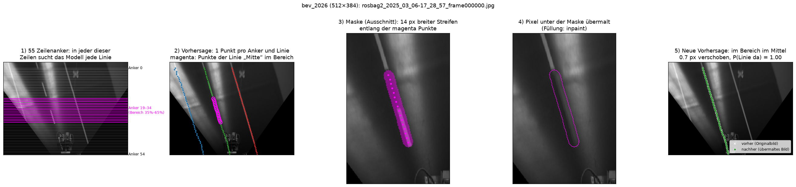
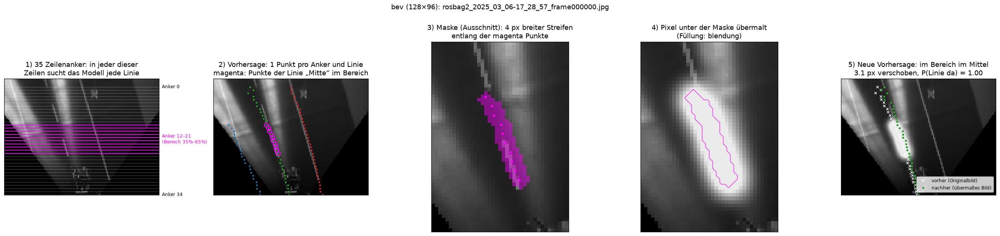
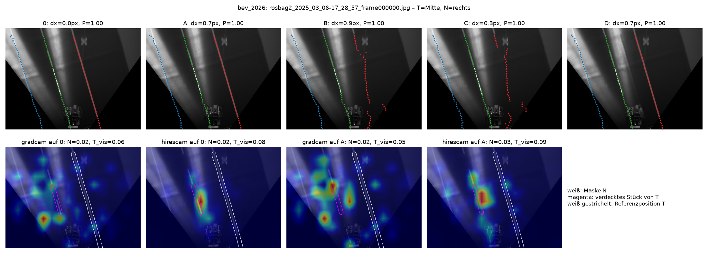
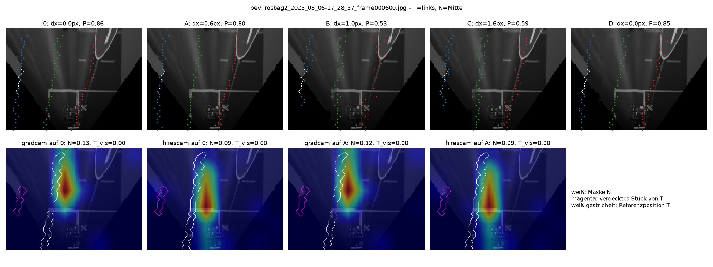
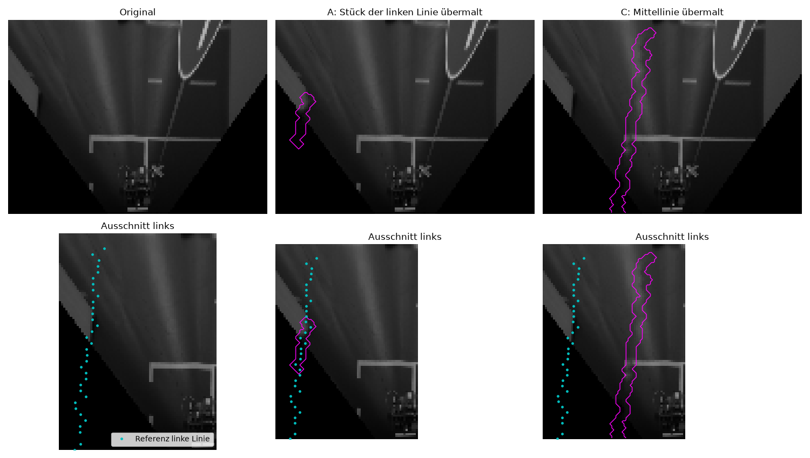
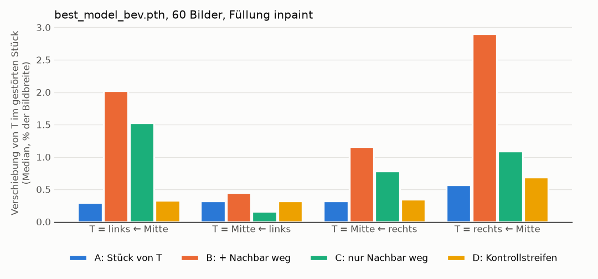

# Wie das Verdeckungsexperiment funktioniert

Diese Doku erklärt Schritt für Schritt, was die Skripte in `experiments/` machen, wie man die
Bilder liest und was bisher herausgekommen ist. Alle Bilder hier erzeugt
`experiments/04_doku_bilder.py` neu.

**Forschungsfrage:** Nutzt die Spurerkennung benachbarte Fahrbahnmarkierungen, um eine teilweise
verdeckte Linie zu erkennen?

**Idee:** Wir verdecken gezielt einzelne Markierungen und schauen, wie sich die Vorhersage ändert.
Danach prüfen wir mit Grad-CAM und HiResCAM, ob die Erklärungsverfahren dieselben Bildbereiche
als wichtig zeigen.

---

## 1. Die untersuchten Modelle

Beide Modelle sind UFLDv2 (Ultra Fast Lane Detection v2) mit ResNet-Backbone `"9"` und erkennen
drei Linien: **links, Mitte, rechts**. Sie bekommen das Kamerabild als Draufsicht (BEV) in Graustufen.

| | `bev` (Standard) | `bev_2026` |
|---|---|---|
| Datei | `models/best_model_bev.pth` | `models/best_model_bev_2026.pth` |
| Config | `config/model_bev_config.py` | `models/best_model_bev_2026_config.py` |
| Eingabegröße | **128 × 96** | 512 × 384 |
| Zeilenanker | 35 | 55 |
| Kästchen („Bins“) pro Anker | 50 | 100 |
| CAM-Schicht (Standard) | `layer3`, 6 × 8 Zellen | `layer4`, 12 × 16 Zellen |

Auswahl in jedem Skript mit `--model bev` oder `--model bev_2026`. Beide werden mit `strict=True`
geladen: Fehlt ein einziges Gewicht, bricht das Laden ab.

---

## 2. Was das Modell eigentlich ausgibt

UFLDv2 malt keine Linien. Es legt **feste waagerechte Zeilen** über das Bild, die
**Zeilenanker**. Für jede Zeile und jede Linie beantwortet es zwei Fragen:

1. **Wo** schneidet die Linie diese Zeile? Die Zeile ist in Kästchen geteilt, und das Modell
   gibt jedem Kästchen eine Punktzahl. Das Kästchen mit der höchsten Punktzahl ergibt die
   x-Position (`loc_row`).
2. **Gibt es** die Linie in dieser Zeile überhaupt? (`exist_row`)

Das Ergebnis ist **ein Punkt pro Zeile und Linie**. Alle Punkte einer Linie zusammen ergeben die
Linie, die man im Bild sieht.

---

## 3. Das Experiment in 5 Schritten

*Modell `bev_2026`, Bild 0, Ziellinie Mitte. Erzeugt mit*
`experiments/03_schritte.py --frame 0 --lane 1 --model bev_2026`.

**1) Zeilenanker.** Die dünnen weißen Striche sind die 55 Zeilen, in denen das Modell sucht.
Anker 0 ist ganz oben, Anker 54 ganz unten. **Magenta** markiert sind die Zeilen, in denen wir
die Linie verdecken. Standard ist `--span 0.35 0.65`, also die Anker zwischen 35 % und 65 % der
Ankerliste. Beim 2026er-Modell sind das die Anker 19–34, beim alten Modell die Anker 12–21.
Weil die Anker fast das ganze Bild von oben bis unten abdecken, entspricht das ungefähr dem
mittleren Drittel des Bildes.

**2) Vorhersage.** Ein Punkt pro Anker und Linie: blau links, grün Mitte, rot rechts. Die magenta
Kreise sind die Punkte der Mittellinie im gewählten Bereich. **Dieses Stück wollen wir
unsichtbar machen**, der Rest der Linie bleibt sichtbar.

**3) Maske.** Die Nahaufnahme zeigt: Wir verbinden die magenta Punkte zu einer Linie und machen sie
14 px dick. Das ergibt die magentafarbene Fläche, die **Maske**. Sie liegt über dem Strich der
Markierung und ist breit genug, dass er ganz darunter verschwindet. Die Breite wächst mit der
Bildgröße mit: 14 px bei 512 px Bildbreite, 4 px bei 128 px.

**4) Übermalen.** Alle Pixel unter der Maske werden ersetzt, hier mit `inpaint`: Die Linie wird
aus der Umgebung heraus wegretuschiert. Das magenta umrandete Stück ist jetzt einfach Straße.

**5) Neue Vorhersage.** Das veränderte Bild geht noch einmal ins Modell.
- Weiße × = Vorhersage auf dem Originalbild
- grüne Punkte = Vorhersage auf dem übermalten Bild

Hier liegen sie fast aufeinander: 0,7 px Verschiebung, die Sicherheit bleibt bei 1,00. Das
2026er-Modell setzt die verdeckte Mittellinie also praktisch an dieselbe Stelle.

Dasselbe mit dem alten Modell. Man sieht, wie grob 128 × 96 Pixel sind:

---

## 4. Die drei Arten zu verdecken (`--fill`)

| Füllung | Was passiert | Wofür |
|---|---|---|
| `inpaint` | Linie wird glatt aus der Umgebung wegretuschiert | realistischste „Linie fehlt“-Variante, **Standard für Auswertungen** |
| `median` | Fläche wird mit dem typischen Straßengrau übermalt | einfach, erzeugt aber sichtbare graue Balken, vor allem im Schatten |
| `blendung` | heller, weich auslaufender Lichtfleck darüber | simuliert Sonne oder Scheinwerfer: Linie und Straße werden gleich hell |

Wichtig: Die Füllung kann selbst das Ergebnis beeinflussen. Deshalb gibt es die
Kontrollbedingung D (nächster Abschnitt). Außerdem sollte jede Aussage mit mindestens zwei
Füllungen geprüft werden.

---

## 5. Die fünf Bedingungen

Für eine **Ziellinie T** und eine **Nachbarlinie N**:

| | Was wird verdeckt | Welche Frage beantwortet es |
|---|---|---|
| **0** | nichts | Referenz, damit vergleichen wir |
| **A** | ein Stück von T | Wie gut schätzt das Modell die Lücke? |
| **B** | ein Stück von T **und** ganz N | Wird es schlechter, wenn auch der Nachbar fehlt? |
| **C** | nur N | Stört das Fehlen von N die vollständig sichtbare Linie T? |
| **D** | ein Stück von T + ein gleich geformter Streifen auf freier Straße zwischen T und N | Kontrolle: Schadet *jede* Bildänderung gleich viel? |

**So liest man das Ergebnis:**
- Ist **B deutlich schlechter als A**, hat das Modell den Nachbarn genutzt.
- Ist **B auch schlechter als D**, liegt das am Nachbarn und nicht daran, dass einfach mehr vom
  Bild verändert wurde.
- Ist **C schon groß**, nutzt das Modell den Nachbarn *immer*, also auch, wenn T selbst gut
  sichtbar ist. Das spricht eher für eine gelernte Spurbreite als für ein gezieltes
  „Lücke füllen“.

**Gemessen wird nur an den Ankern des verdeckten Stücks von T:**
- `dx_mittel_px`: mittlere Verschiebung zur Referenz in Pixeln der Modellauflösung
- `dx_mittel_pct`: dasselbe in **% der Bildbreite**. Nur damit lassen sich die beiden Modelle
  vergleichen, denn 1 px bei 128 px Breite entspricht 4 px bei 512 px.
- `P_exist_T`: Wahrscheinlichkeit, dass das Modell die Linie dort noch sieht
- `Anker_verloren`: Anker, an denen das Modell die Linie gar nicht mehr findet

**Die Referenz ist die Vorhersage auf dem Originalbild.** Labels gibt es keine. Gemessen wird
also, wie stark sich das Modell durch die Verdeckung *ändert*, nicht, wie richtig es ist.

---

## 6. Die Übersichtsabbildung lesen (`01_first_look.py`)

**Obere Reihe:** die fünf Bedingungen. Die farbigen Punkte sind die Vorhersagen, die weiß
gestrichelte Linie ist die Referenzposition des verdeckten Stücks. Im Titel stehen Verschiebung
und Sicherheit.

**Untere Reihe:** die Erklärungskarten für das verdeckte Stück von T, berechnet auf dem
Originalbild (0) und auf Bild A.
- **Rot** heißt: Dieser Bereich hat die Vorhersage stark beeinflusst.
- **Weiß** umrandet ist die Nachbarlinie N, **magenta** das verdeckte Stück von T.
- `N=0.02` heißt: 2 % der gesamten Karte liegen auf der Nachbarlinie.

**Grad-CAM gegen HiResCAM:**
- **Grad-CAM** mittelt die Gradienten eines Kanals über das ganze Bild und gewichtet damit den Kanal.
- **HiResCAM** verrechnet Gradient und Aktivierung Zelle für Zelle.

Bei UFLDv2 ist der Unterschied wichtig, weil der Kopf aus Fully-Connected-Schichten besteht.
Dort ist der Gradient an jeder Bildstelle anders, und das Mitteln verwischt das. Im Bild sieht
man es deutlich: HiResCAM konzentriert sich auf die Mittellinie, Grad-CAM verteilt sich über
das halbe Bild.

**Was die Karte erklärt (`RowBinTarget`):** die Punktzahl, die das Modell im Originalbild den
gewählten Kästchen der verdeckten Anker gegeben hat. Übersetzt: *„Welche Bildbereiche halten die
Linie an ihrer Stelle?“*

---

## 7. Vorsicht: Wir verdecken, wo das Modell eine Linie *vermutet*

Ohne Labels folgen die Masken den **Vorhersagen**. Bei gut sichtbaren Linien wie in Bild 0
ist das kein Problem. Bild 600 zeigt aber, was schiefgehen kann:

- **Links gibt es keine Markierung.** Die türkisen Punkte, also die „linke Linie“ des Modells,
  laufen oben an einer Bordsteinkante und unten am schwarzen Rand des Bildausschnitts entlang.
  Die Maske in A übermalt deshalb nur Kante und Schwarz. Dass in A kaum etwas passiert, ist hier
  kein Befund.
- **Das Bild zeigt eine Kreuzung.** Die Maske für die „Mittellinie“ (C) liegt auf Straße und
  schneidet das linke Ende der Haltelinie ab. Dass die Sicherheit für links in C von 0,86 auf
  0,59 fällt, liegt vermutlich an der fehlenden Haltelinien-Ecke und nicht an einer fehlenden
  Mittellinie.

**Was das für die Auswertung heißt:** Wir müssen Bilder trennen, in denen T und N wirklich
sichtbare Markierungen sind, und Bilder, in denen eine Linie nur geraten ist. Die
Sichtbarkeitsprüfung dafür ist noch offen (siehe Abschnitt 10).

---

## 8. Bisherige Ergebnisse (`02_batch.py`, Modell `bev`)

60 Testbilder (jedes 20. der Fahrt), 4 Linienpaare, Füllung `inpaint`. 34 Kombinationen wurden
übersprungen, weil T oder N nicht erkannt wurde, meist die linke Linie.

Die Pfeile lesen sich so: „T ← N“ heißt, Ziellinie T wird mit Nachbar N untersucht.
Alle Werte sind Mediane in % der Bildbreite.

| T ← N | Bilder | A | B | C | D | B > A bei | p (B > A) | p (B > D) |
|---|---|---|---|---|---|---|---|---|
| links ← Mitte | 50 | 0,29 | **2,02** | 1,52 | 0,33 | 88 % | 3·10⁻⁸ | 1·10⁻⁶ |
| Mitte ← links | 56 | 0,32 | 0,45 | 0,16 | 0,32 | 61 % | 2·10⁻⁴ | 0,009 |
| Mitte ← rechts | 58 | 0,32 | **1,16** | 0,78 | 0,35 | 93 % | 3·10⁻¹⁰ | 1·10⁻⁸ |
| rechts ← Mitte | 59 | 0,57 | **2,91** | 1,09 | 0,69 | 95 % | 8·10⁻¹¹ | 1·10⁻⁹ |

Die p-Werte stammen aus einem einseitigen Wilcoxon-Vorzeichen-Rang-Test, gepaart über die Bilder.

**Was man daraus lesen kann:**

1. **Das alte Modell nutzt die Nachbarlinien.** In allen vier Fällen ist B signifikant
   schlechter als A und als die Kontrolle D. Am stärksten hängen die **Außenlinien an der
   Mittellinie**. Die Mitte hängt eher an der rechten als an der linken Linie, denn links ist oft
   gar keine echte Markierung zu sehen.
2. **Das ist aber vor allem ein allgemeiner Effekt.** Schon C, bei dem T komplett sichtbar
   bleibt, verschiebt T deutlich. Bei „links ← Mitte“ ist B ungefähr A + C. Das Modell scheint eine
   **Spurbreite gelernt** zu haben und setzt die Linien relativ zueinander. Ein gezieltes
   „Lücke mit Hilfe des Nachbarn füllen“ lässt sich daraus nicht ablesen.
3. **Die Effekte sind klein, aber sehr regelmäßig:** 1–3 % der Bildbreite, also 1–4 px bei
   128 px. Signifikant werden sie, weil sie in fast allen Bildern in dieselbe Richtung gehen.
4. **Die Erklärungen passen nur teilweise.**
   - Bei „links ← Mitte“ zeigt nur HiResCAM überdurchschnittlich viel auf die Mittellinie, das
     1,6-Fache des Flächenanteils. Grad-CAM zeigt fast nichts, nur das 0,09-Fache.
   - Pro Bild hängen CAM-Anteil und Effekt nur schwach zusammen (Spearman zwischen −0,25 und
     +0,45).
   - Beim alten Modell ist die Karte mit 6 × 8 Zellen aber auch sehr grob.

Ergebnisse für `bev_2026` folgen, sobald der Batch-Lauf durch ist.

**Erste Beobachtung zur Blendung** (einzelnes Bild, noch keine Statistik): Ein Lichtfleck auf
der freien Straße *zwischen* zwei Linien (Bedingung D mit `blendung`) verschiebt beim alten Modell
die Linie um fast 20 % der Bildbreite. Das Modell hält den hellen Fleck offenbar selbst für eine
Linie.

---

## 9. Selbst ausführen

Alle Befehle im Projektordner `~/Documents/xai_lane_paper`.

| Was | Befehl | Ergebnis |
|---|---|---|
| Setup prüfen | `.venv/bin/python experiments/00_check_setup.py` | Modell lädt, Ausgabeformen |
| Ein Bild, alle Bedingungen + CAM | `.venv/bin/python experiments/01_first_look.py --frame 0 --lane 1 --neighbor 2` | `results/<modell>/01_first_look/` |
| Viele Bilder + Statistik | `.venv/bin/python experiments/02_batch.py --step 20` | `results/<modell>/02_batch/` |
| Abgebrochenen Lauf fortsetzen | `.venv/bin/python experiments/02_batch.py --step 20 --resume` | |
| Nur Statistik neu rechnen | `.venv/bin/python experiments/02_batch.py --summary-only` | |
| Schritt-für-Schritt-Abbildung | `.venv/bin/python experiments/03_schritte.py --frame 0 --lane 1` | `results/<modell>/03_schritte/` |
| Bilder dieser Doku neu erzeugen | `.venv/bin/python experiments/04_doku_bilder.py` | `docs/bilder/` |
| **Interaktiv ausprobieren** | `experiments/interaktiv.ipynb` in VS Code öffnen, Kernel `.venv`, *Run All* | Regler für Bild, Linie, Bedingung, Füllung |

**Häufige Optionen:**
- `--model bev|bev_2026` wählt das Modell.
- `--lane` / `--neighbor` wählen die Linien: 0 = links, 1 = Mitte, 2 = rechts.
- `--span 0.2 0.8` verdeckt ein größeres Stück.
- `--fill inpaint|median|blendung` wählt die Füllung.
- `--layer layer2|layer3|layer4` wählt die CAM-Schicht.

**Laufzeit von `02_batch.py --step 20`:** etwa 1 Stunde mit `bev_2026`, wenige Minuten mit `bev`.
Das Skript speichert nach jedem Bild, deshalb lässt sich ein Abbruch mit `--resume` fortsetzen.

---

## 10. Offene Punkte

- **Sichtbarkeitsprüfung:** Ist eine Linie unter der Maske deutlich heller als die Straße daneben?
  Nur dann gilt sie als echte Markierung, und die Statistik wird getrennt nach „sichtbar“ und
  „geraten“ ausgewertet.
- **Kreuzungen** mit Haltelinie und Abbiegungen markieren oder ausschließen.
- **Interaktion als Kennzahl:** (B − A) − C trennt „Lücke füllen mit Hilfe des Nachbarn“ von
  „Nachbar wirkt sowieso immer“.
- **Batch mit `blendung`**, um die Robustheit gegen Lichteinfall mit Zahlen zu belegen. Das ist
  die Grundlage, um später durch Training mit künstlichen Lichtflecken (Data Augmentation) ein
  robusteres Modell zu bauen und vorher/nachher zu vergleichen.
- Die Ankerformel `row_anchor = linspace(100, 1540, num_row) / 1550` mit dem Team abklären (siehe
  README).
